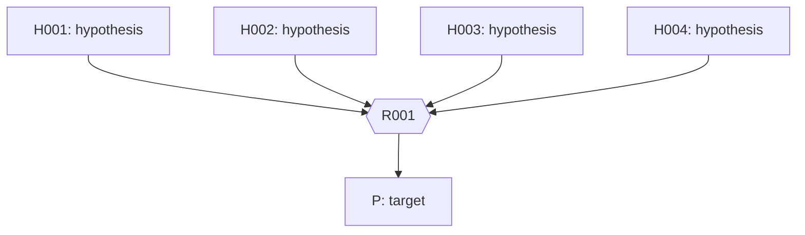

# NL0 — lie-module-irreducibility

> Generated from canonical nl0.json and spec.json. Do not edit this view.

## Frozen original target

For every prime p, every field K of characteristic p, every integer lambda with 0 <= lambda < p, and every admissible lattice M in the complex irreducible highest-weight sl2-module V(lambda), prove that M tensor_Z K is irreducible as the scalar-extension Lie algebra L(K)-module.

## Original hypotheses

- **H001**: p is prime.
- **H002**: K is a field of characteristic p.
- **H003**: lambda is an integer and 0 <= lambda < p.
- **H004**: V(lambda) is the complex irreducible highest-weight sl2-module of highest weight lambda, with generators x,y,h satisfying [h,x]=2x, [h,y]=-2y, [x,y]=h and a nonzero highest-weight vector v with xv=0 and hv=lambda v; it has dimension lambda+1. M is any free abelian subgroup of V(lambda) whose Z-basis is a C-basis and for which U_Z M is contained in M, where U_Z is generated by X_r=x^r/r! and Y_r=y^r/r! for integers r>=0.

## Declared parameters and logical primitives

- `p`: prime number.
- `K`: field.
- `lambda`: integer.
- `M`: admissible lattice in V(lambda) over Z.
- `C`: field. Complex field.
- `Z_(p)`: ring. Localization of Z at p.
- `U_Z`: Z-algebra of operators. Generated by divided powers X_r,Y_r.
- `L(K)`: Lie algebra. Scalar extension of the Chevalley Z-form acting on M tensor K.
- `Z`: ring. Integers.
- `V(lambda)`: complex vector space. Given highest-weight representation.
- `x`: linear operator. Raising generator.
- `y`: linear operator. Lowering generator.
- `h`: linear operator. Cartan generator.
- `v`: vector. Given highest-weight vector.

## Global definitions and notation

## Bipartite proof graph

## Source propositions

## Derived propositions and their arguments

### P — R001

M tensor_Z K is irreducible as an L(K)-module, meaning it is nonzero and each K-linear subspace invariant under x,y,h is either zero or the whole space.

Inputs: H001, H002, H003, H004. Rules: direct.

Statement binders: []

Local declarations: [{"symbol": "R", "type": "Z_(p)", "scope": "R001", "start": "S001", "end": "S005", "kind": "definition", "declaration": "Define R=Z_(p).", "from_inputs": ["H001", "H003"], "from_local": [], "objects": ["Z", "p"]}, {"symbol": "n", "type": "lambda+1", "scope": "R001", "start": "S001", "end": "S005", "kind": "definition", "declaration": "Define n=lambda+1.", "from_inputs": ["H003"], "from_local": [], "objects": ["lambda"]}, {"symbol": "e_i", "type": "y^i v/i! vector", "scope": "R001", "start": "S001", "end": "S005", "kind": "definition", "declaration": "Define e_i=y^i v/i! for 0<=i<=lambda.", "from_inputs": ["H004"], "from_local": [], "objects": ["y", "v", "lambda"]}, {"symbol": "X_r", "type": "x^r/r! operator", "scope": "R001", "start": "S001", "end": "S005", "kind": "definition", "declaration": "Define X_r=x^r/r!.", "from_inputs": ["H004"], "from_local": [], "objects": ["x"]}, {"symbol": "Y_r", "type": "y^r/r! operator", "scope": "R001", "start": "S001", "end": "S005", "kind": "definition", "declaration": "Define Y_r=y^r/r!.", "from_inputs": ["H004"], "from_local": [], "objects": ["y"]}, {"symbol": "M_R", "type": "R tensor_Z M", "scope": "R001", "start": "S001", "end": "S005", "kind": "definition", "declaration": "Define M_R=R tensor_Z M embedded in V(lambda).", "from_inputs": ["H004"], "from_local": [], "objects": ["R", "M", "Z", "V(lambda)"]}, {"symbol": "E_ab", "type": "matrix unit", "scope": "R001", "start": "S002", "end": "S005", "kind": "definition", "declaration": "Define E_ab(e_b)=e_a and E_ab(e_t)=0 for t!=b.", "from_inputs": [], "from_local": [], "objects": ["e_i"]}, {"symbol": "E_i,j", "type": "matrix unit", "scope": "R001", "start": "S002", "end": "S008", "kind": "definition", "declaration": "Define E_i,j(e_j)=e_i and E_i,j(e_t)=0 for t!=j.", "from_inputs": [], "from_local": [], "objects": ["e_i"]}, {"symbol": "J_i", "type": "{c in C:c e_i in M_R}", "scope": "R001", "start": "S003", "end": "S005", "kind": "definition", "declaration": "Define J_i={c in C:c e_i in M_R}.", "from_inputs": [], "from_local": [], "objects": ["C", "e_i", "M_R"]}, {"symbol": "J", "type": "common J_i", "scope": "R001", "start": "S003", "end": "S005", "kind": "definition", "declaration": "Let J be the common J_i.", "from_inputs": [], "from_local": [], "objects": ["J_i"]}, {"symbol": "Q", "type": "Frac(R)", "scope": "R001", "start": "S003", "end": "S005", "kind": "definition", "declaration": "Let Q=Frac(R).", "from_inputs": [], "from_local": [], "objects": ["R"]}, {"symbol": "a", "type": "generator of J", "scope": "R001", "start": "S004", "end": "S005", "kind": "witness", "declaration": "Choose generator a of rank-one free J using F001.", "from_inputs": [], "from_local": ["F001"], "objects": ["J"]}, {"symbol": "F_p", "type": "prime subfield of K, canonically R/pR", "scope": "R001", "start": "S004", "end": "S005", "kind": "definition", "declaration": "Let F_p be the prime subfield of K, canonically isomorphic to R/pR=Z/pZ.", "from_inputs": ["H001", "H002"], "from_local": [], "objects": ["p", "K", "R"]}, {"symbol": "W", "type": "invariant K-subspace", "scope": "R001", "start": "S005", "end": "S008", "kind": "arbitrary", "declaration": "Let W be any K-subspace invariant under x,y,h.", "from_inputs": ["H002", "H003", "H004"], "from_local": [], "objects": ["K", "M", "x", "y", "h"]}, {"symbol": "r", "type": "integer with 0<=r<=lambda", "scope": "R001", "start": "S005", "end": "S005", "kind": "arbitrary", "declaration": "Fix arbitrary r with 0<=r<=lambda.", "from_inputs": ["H003"], "from_local": [], "objects": ["lambda"]}, {"symbol": "b_i", "type": "image of a e_i in M_R/pM_R and its scalar extension to M tensor_Z K", "scope": "R001", "start": "S004", "end": "S008", "kind": "definition", "declaration": "For each 0<=i<=lambda, define b_i as the image of a e_i under M_R -> M_R/pM_R and then under the canonical identification (M_R/pM_R) tensor_F_p K = M tensor_Z K.", "from_inputs": [], "from_local": ["F001"], "objects": ["a", "e_i", "M_R", "F_p", "K", "M"]}, {"symbol": "Id", "type": "identity operator on V(lambda)", "scope": "S001", "start": "S001", "end": "S001", "kind": "definition", "declaration": "Let Id denote the identity linear operator on V(lambda).", "from_inputs": ["H004"], "from_local": [], "objects": ["V(lambda)"]}, {"symbol": "alpha_i", "type": "complex scalar lambda-2i for 0<=i<=lambda", "scope": "R001", "start": "S001", "end": "S001", "kind": "definition", "declaration": "For each integer i with 0<=i<=lambda define alpha_i=lambda-2i in C.", "from_inputs": ["H003", "H004"], "from_local": [], "objects": ["lambda", "C"]}, {"symbol": "c_i", "type": "complex scalar coefficients in the relation in S001", "scope": "R001", "start": "S001", "end": "S001", "kind": "arbitrary", "declaration": "For each integer i with 0<=i<=lambda, let c_i be an arbitrary complex scalar in the relation sum_i c_i e_i=0.", "from_inputs": ["H003", "H004"], "from_local": [], "objects": ["C", "lambda"]}, {"symbol": "c", "type": "complex scalar", "scope": "R001", "start": "S003", "end": "S008", "kind": "arbitrary", "declaration": "Fix an arbitrary complex scalar c when defining and comparing the coordinate modules J_i.", "from_inputs": ["H004"], "from_local": [], "objects": ["C"]}, {"symbol": "t", "type": "integer index with 0<=t<=lambda", "scope": "R001", "start": "S002", "end": "S002", "kind": "arbitrary", "declaration": "Fix an arbitrary index t with 0<=t<=lambda in the definition of the matrix units.", "from_inputs": ["H003"], "from_local": [], "objects": ["lambda"]}, {"symbol": "i", "type": "integer index 0 through lambda", "scope": "index-S001", "start": "S001", "end": "S005", "kind": "arbitrary", "declaration": "Fix an arbitrary integer index i from 0 through lambda in S001.", "from_inputs": ["H003"], "from_local": [], "objects": ["lambda"]}, {"symbol": "j", "type": "integer index 0 through lambda", "scope": "index-j", "start": "S001", "end": "S008", "kind": "arbitrary", "declaration": "Fix an arbitrary integer index j from 0 through lambda in the indexed basis calculations.", "from_inputs": ["H003"], "from_local": [], "objects": ["lambda"]}, {"symbol": "k", "type": "integer index 0 through lambda", "scope": "index-k", "start": "S001", "end": "S002", "kind": "arbitrary", "declaration": "Fix an arbitrary integer index k from 0 through lambda in the indexed basis calculations.", "from_inputs": ["H003"], "from_local": [], "objects": ["lambda"]}, {"symbol": "r", "type": "nonnegative integer exponent/index", "scope": "index-r", "start": "S001", "end": "S002", "kind": "arbitrary", "declaration": "Fix an arbitrary nonnegative integer r in the divided-power formulas.", "from_inputs": ["H003"], "from_local": [], "objects": ["lambda"]}, {"symbol": "E_i,lambda", "type": "matrix unit with row i and column lambda", "scope": "S002", "start": "S002", "end": "S005", "kind": "definition", "declaration": "Use E_i,lambda for the matrix unit with row i and column lambda in the e-basis.", "from_inputs": [], "from_local": [], "objects": ["e_i", "lambda"]}, {"symbol": "E_lambda,j", "type": "matrix unit with row lambda and column j", "scope": "S002", "start": "S002", "end": "S005", "kind": "definition", "declaration": "Use E_lambda,j for the matrix unit with row lambda and column j in the e-basis.", "from_inputs": [], "from_local": [], "objects": ["e_i", "lambda"]}, {"symbol": "R-algebra", "type": "algebra over R generated by the divided powers", "scope": "S002", "start": "S002", "end": "S002", "kind": "definition", "declaration": "The R-algebra generated by the divided powers means their unital R-subalgebra in the endomorphisms of M_R.", "from_inputs": [], "from_local": [], "objects": ["R", "M_R", "X_r", "Y_r"]}, {"symbol": "factorials", "type": "factorials of nonnegative integers", "scope": "S001", "start": "S001", "end": "S005", "kind": "definition", "declaration": "Use m! for the usual integer factorial of each nonnegative integer m, with 0!=1.", "from_inputs": ["H003"], "from_local": [], "objects": ["lambda"]}, {"symbol": "binomial coefficients", "type": "integer binomial coefficients", "scope": "S001", "start": "S001", "end": "S005", "kind": "definition", "declaration": "Use binomial coefficients in their usual integer meaning, with value zero outside the valid nonnegative index range.", "from_inputs": ["H003"], "from_local": [], "objects": ["lambda"]}, {"symbol": "basis", "type": "basis of V(lambda)", "scope": "S001", "start": "S001", "end": "S005", "kind": "definition", "declaration": "The phrase basis refers to a linearly independent spanning family in the indicated vector space.", "from_inputs": ["H004"], "from_local": [], "objects": ["V(lambda)"]}, {"symbol": "E_lambda,lambda", "type": "matrix unit with row and column lambda", "scope": "S002", "start": "S002", "end": "S005", "kind": "arbitrary", "declaration": "Use E_lambda,lambda for the matrix unit with row and column lambda in the e-basis.", "from_inputs": [], "from_local": [], "objects": ["e_i", "lambda"]}, {"symbol": "Frac(R)", "type": "field of fractions of R", "scope": "R001", "start": "S003", "end": "S005", "kind": "definition", "declaration": "Let Frac(R) denote the field of fractions of the integral domain R; Q is this field.", "from_inputs": [], "from_local": [], "objects": ["R"]}, {"symbol": "rank_R", "type": "Q-dimension of Q tensor_R N for a finitely generated torsion-free R-module N", "scope": "R001", "start": "S003", "end": "S003", "kind": "definition", "declaration": "For any finitely generated torsion-free R-module N, define rank_R(N)=dim_Q(Q tensor_R N), where Q=Frac(R); this definition does not presuppose that N is free.", "from_inputs": [], "from_local": [], "objects": ["R"]}, {"symbol": "coordinate projections", "type": "coordinate projection maps for the direct-sum decomposition", "scope": "R001", "start": "S003", "end": "S003", "kind": "definition", "declaration": "Coordinate projections are the canonical projections onto each summand in the displayed direct sum decomposition.", "from_inputs": [], "from_local": [], "objects": ["M_R", "J", "e_i"]}, {"symbol": "ideal generators", "type": "generators of the ideal obtained after clearing denominators", "scope": "R001", "start": "S003", "end": "S003", "kind": "definition", "declaration": "The finite set of ideal generators refers to any finite generating set of the ideal obtained by clearing denominators.", "from_inputs": [], "from_local": [], "objects": ["R", "J"]}, {"symbol": "tensor products", "type": "tensor product constructions and scalar extension maps", "scope": "R001", "start": "S004", "end": "S004", "kind": "definition", "declaration": "Tensor products and scalar extensions in the stated canonical identifications have their usual algebraic meanings.", "from_inputs": ["H002", "H004"], "from_local": [], "objects": ["R", "M", "K", "F_p"]}, {"symbol": "operator matrices", "type": "matrices of the indicated linear operators in a specified basis", "scope": "R001", "start": "S004", "end": "S004", "kind": "definition", "declaration": "An operator matrix is the matrix representing the stated linear operator in the stated basis.", "from_inputs": ["H004"], "from_local": [], "objects": ["x", "y", "h", "e_i"]}, {"symbol": "module dimension", "type": "dimension of M tensor_Z K over K", "scope": "S005", "start": "S005", "end": "S008", "kind": "definition", "declaration": "The module dimension is its vector-space dimension over K, equal to lambda+1 by the basis correspondence in S004.", "from_inputs": ["H002", "H003", "H004"], "from_local": [], "objects": ["M", "K", "lambda"]}, {"symbol": "L1", "type": "assumption that W is nonzero", "scope": "nonzero-W-branch", "start": "S005", "end": "S008", "kind": "arbitrary", "declaration": "Temporarily assume that the arbitrary invariant subspace W is nonzero; this assumption is discharged by the zero/nonzero case argument.", "from_inputs": [], "from_local": [], "objects": ["W"]}, {"symbol": "w0", "type": "vector in M tensor_Z K", "scope": "nonzero-witness", "start": "S006", "end": "S007", "kind": "witness", "declaration": "Choose w0 in W with w0 nonzero using the earlier local existence fact F002.", "from_inputs": [], "from_local": ["F002"], "objects": ["W", "M", "K"]}, {"symbol": "c_i", "type": "K-scalar coordinates of w in the b-basis", "scope": "coordinates-of-w", "start": "S006", "end": "S007", "kind": "definition", "declaration": "Define the unique coordinates c_i in K by the expansion of the selected vector w0 in the established K-basis b_0,...,b_lambda.", "from_inputs": ["H002", "H003"], "from_local": ["F002"], "objects": ["w0", "b_i", "K", "lambda"]}, {"symbol": "i", "type": "integer index 0<=i<=lambda with c_i nonzero", "scope": "selected-coordinate", "start": "S007", "end": "S007", "kind": "witness", "declaration": "Choose i with 0<=i<=lambda and c_i nonzero using the local existence fact F003.", "from_inputs": [], "from_local": ["F003"], "objects": ["c_i", "lambda"]}]

1. Let R=Z_(p), n=lambda+1, and e_i=y^i v/i! for 0<=i<=lambda. First prove these are a C-basis. Iterating [x,y]=h and [h,y]=-2y gives h(y^i v)=(lambda-2i)y^i v and, for 1<=i<=lambda, x(y^i v)=i(lambda-i+1)y^(i-1)v. Iterating the latter identity gives x^i y^i v=i! lambda(lambda-1)...(lambda-i+1)v. This scalar is nonzero in C and v is nonzero, so y^i v and e_i are nonzero (also e_0=v is nonzero). The h-eigenvalues alpha_i=lambda-2i are pairwise distinct: alpha_i-alpha_j=2(j-i) is nonzero in C for i!=j. For any relation sum_i c_i e_i=0, fix j and apply the operator product over k!=j of (h-alpha_k Id). Since h e_i=alpha_i e_i, this gives c_j product_{k!=j}(alpha_j-alpha_k)e_j=0, hence c_j=0; thus the e_i are linearly independent. There are lambda+1 of them and dim_C V(lambda)=lambda+1 by H004. If they did not span, adjoining a vector outside their span would give lambda+2 linearly independent vectors, contradicting that dimension. Thus they are a basis. Also y^(lambda+1)v, if nonzero, would be an h-eigenvector of eigenvalue -lambda-2 by the same h-y relation. This eigenvalue differs from every alpha_i, whereas in the established basis h is diagonal with eigenvalues alpha_0,...,alpha_lambda; a nonzero vector cannot be an eigenvector for another eigenvalue. Hence y^(lambda+1)v=0, and all higher y-powers vanish. The x-action stops at e_0 because xv=0, so higher x-powers on e_i vanish once their index would be negative. Iterating the relations therefore gives, for r>=0, X_r e_i=binom(lambda-i+r,r)e_(i-r) when 0<=r<=i and zero when r>i; and Y_r e_i=binom(i+r,r)e_(i+r) when i+r<=lambda and zero when i+r>lambda. In each case the zero is the just-proved termination of the respective string, not an assumption about an undefined basis vector. In the valid ranges these formulas follow by dividing x^r y^i v and y^(i+r)v by r!i! and using the displayed factorial coefficients. Thus the divided powers have integral matrices in this basis. Put M_R=R tensor_Z M inside V(lambda). Admissibility implies the R-algebra generated by all X_r,Y_r preserves M_R.

   Inputs used: H001, H003, H004. Introduces: none. Discharges: none.

   Step S001; objects: R, Z, p, n, lambda, e_i, i, y, v, x, h, C, alpha_i, j, k, Id, c_i, X_r, Y_r, r, binomial coefficients, factorials, V(lambda), M_R, M, U_Z, basis; prior local facts: none.

2. Using the basis proved in S001, define E_ab by E_ab(e_b)=e_a and E_ab(e_t)=0 for t!=b. The divided-power formulas give Y_lambda X_lambda=E_lambda,lambda: X_lambda kills e_i for i<lambda and sends e_lambda to e_0, while Y_lambda sends e_0 to e_lambda. They also give X_(lambda-i)E_lambda,lambda=E_i,lambda, since X_(lambda-i)e_lambda=e_i, and E_lambda,lambda Y_(lambda-j)=binom(lambda,j)E_lambda,j. Indeed, for an input e_k with k<j, the divided-power formula gives Y_(lambda-j)e_k=binom(k+lambda-j,lambda-j)e_(k+lambda-j), which is generally nonzero but has index less than lambda and is killed by E_lambda,lambda; for k=j it gives binom(lambda,j)e_lambda; and for k>j the Y-string has passed its endpoint, so Y_(lambda-j)e_k=0. Thus the stated identity is for the composite, not a claim that Y_(lambda-j) itself vanishes on every other basis vector. Since 0<=j<=lambda<p, neither lambda! nor j!(lambda-j)! is divisible by p, so binom(lambda,j) is a unit in R=Z_(p); this includes lambda=0 (the empty factorial is 1) and p=2. Therefore every E_i,j belongs to the R-algebra generated by the divided powers and preserves M_R.

   Inputs used: H001, H003, H004. Introduces: none. Discharges: none.

   Step S002; objects: R, Z, p, lambda, i, j, k, t, e_i, E_ab, E_lambda,lambda, E_i,lambda, E_lambda,j, X_r, Y_r, M_R, binomial coefficients, factorials, R-algebra; prior local facts: none.

3. For each i set J_i={c in C: c e_i is in M_R}. First, M_R is finite free over R: if m_1,...,m_n is the original Z-basis of M, then 1 tensor m_1,...,1 tensor m_n is an R-basis of R tensor_Z M, since the Z-coordinate isomorphism M≅Z^n extends to the explicit isomorphism R tensor_Z M≅R^n. The image E_i,i(M_R)=J_i e_i is finitely generated over R: it is the image of this finite module under the R-linear projection E_i,i. It is nonzero because M_R spans V(lambda) over C and E_i,i is a nonzero projection. Since E_i,j preserves M_R, applying it to c e_j proves J_j subset J_i; reversing i,j proves equality. Denote the common module by J. The coordinate projections give the internal direct sum M_R=⊕_{i=0}^{lambda} J e_i: each vector has its unique e-coordinate expansion, and its i-th coordinate belongs to J_i by the definition of J_i. Thus J is finitely generated (as just shown) and torsion-free, since it is an R-submodule of the field C and R is a domain. We now compute scalar-extension dimension before using any rank-one or ideal conclusion. Let Q=Frac(R), and let ι:Q tensor_R M_R→Q^n be the isomorphism obtained by extending the displayed original-basis coordinate isomorphism R tensor_Z M≅R^n; hence dim_Q(Q tensor_R M_R)=n. Tensor the coordinate direct-sum isomorphism with Q. The explicit compatible isomorphism ⊕_{i=0}^{lambda}(Q tensor_R J)→Q tensor_R M_R sends the i-th summand element q tensor c to q tensor(c e_i); its inverse is induced by the coordinate projections onto J e_i followed by e_i-coordinate extraction. Consequently, writing d=dim_Q(Q tensor_R J), finite because J is finitely generated, dimensions give n=(lambda+1)d=nd. Since n=lambda+1 is a positive integer, d=1. In particular the scalar-extension map μ:Q tensor_R J→C, q tensor c↦qc, is injective: Q tensor_R J is the localization of the R-submodule J⊂C, and an element maps to zero only if some nonzero denominator multiplier annihilates an element of J, which torsion-freeness forbids. Its image is nonzero (J is nonzero) and one-dimensional over Q, so choosing any nonzero image element identifies Q tensor_R J with Q as a Q-vector space. This proves the rank-one identification without assuming J free. Now use μ to regard J as a nonzero finitely generated R-submodule of Q. Clear denominators in a finite generating set to obtain a nonzero finitely generated ideal I of R with I=d_0J for some nonzero d_0 in R. Every nonzero q in Q is p^k u for an integer k and a unit u in R; among a finite set of nonzero generators of I choose the least exponent k. Every generator is in p^k R and one is p^k times a unit, so I=p^k R. Hence J is free of rank one. For a generator a of J, the vectors a e_i form an R-basis of M_R by the direct-sum decomposition.

   Inputs used: H001, H003, H004. Introduces: none. Discharges: none.

   Step S003; objects: R, Z, p, Q, Frac(R), M_R, J_i, J, E_i,j, e_i, C, c, n, rank_R, ideal generators, coordinate projections; prior local facts: none.

   F001: There exists a generator a of J and J is free of rank one over R. Active assumptions: none.

4. For the generator a of J from F001, the vectors a e_i form an R-basis of M_R by the direct-sum decomposition and J=Ra proved in S003. Define b_i to be the image of a e_i in M_R/pM_R and then its image under (M_R/pM_R) tensor_F_p K = M tensor_Z K; these b_i form a K-basis. The divided-power formulas at r=1 give x(ae_i)=(lambda-i+1)ae_(i-1), y(ae_i)=(i+1)ae_(i+1), and h(ae_i)=(lambda-2i)ae_i, with the first term zero at i=0 (because xe_0=0) and the second zero at i=lambda (because y e_lambda=0 as established in S001). These integral action matrices reduce to exactly x b_i=(lambda-i+1)b_(i-1), y b_i=(i+1)b_(i+1), and h b_i=(lambda-2i)b_i over F_p and K, with the same endpoint zero actions. A Z-basis of M and its reduction identify M_R/pM_R with M tensor_Z F_p. Since K has characteristic p, extension of scalars identifies (M tensor_Z F_p) tensor_F_p K with M tensor_Z K and preserves these operator matrices. Thus this is an L(K)-module basis and action correspondence; no assumption that the h-eigenvalues remain distinct modulo p is involved.

   Inputs used: H002, H003, H004. Introduces: none. Discharges: none.

   Step S004; objects: R, Z, p, a, e_i, b_i, x, y, h, lambda, i, M_R, F_p, K, M, L(K), tensor products, operator matrices; prior local facts: F001.

5. For each 0<=r<=lambda<p, r! is invertible modulo p, so X_r and Y_r on the reduced module are the respective nonzero scalar multiples 1/r! of x^r and y^r; for r=0 the scalar is 1. The matrix-unit identities from S002 persist after reduction: their coefficients binom(lambda,j) are nonzero modulo p, and the same identities hold as operators on the K-basis b_0,...,b_lambda corresponding to the characteristic-zero e-basis. Thus any K-subspace W invariant under x and y is invariant under every E_i,j. Let W be arbitrary. If W=0, it is the zero subspace. For the other case, temporarily assume L1: W is nonzero. By the definition of nonzero subspace, there exists a vector w0 in W with w0 nonzero; record this existence before selecting w0 in S006.

   Inputs used: H002, H003, H004. Introduces: L1. Discharges: none.

   Step S005; objects: R, Z, p, r, lambda, X_r, Y_r, x, y, E_i,j, i, j, K, W, b_i, module dimension, factorials, binomial coefficients; prior local facts: none.

   F002: There exists w0 in W such that w0 is nonzero. Active assumptions: L1.

6. By existential elimination applied to the existence fact F002, choose a witness w0 in W with w0 nonzero; its private identity is used only in this branch. Since b_0,...,b_lambda were established in S004 as a K-basis of M tensor_Z K, there are unique scalars c_i in K with w0=sum_i c_i b_i. At least one coefficient is nonzero, since if all c_i were zero the displayed expansion would give w0=0, contrary to the witness property. Choose an index i in the range 0<=i<=lambda with c_i nonzero; establish this existential fact before selecting i.

   Inputs used: local calculation/logic. Introduces: none. Discharges: none.

   Step S006; objects: w0, W, b_i, K, lambda; prior local facts: F002.

   F003: There exists an index i with 0<=i<=lambda and c_i is nonzero. Active assumptions: L1.

7. By existential elimination from F003 choose such an index i. For every j with 0<=j<=lambda, matrix-unit action gives E_j,i w0=c_i b_j. Because W is invariant under x and y it is invariant under E_j,i, so E_j,i w0 lies in W. The scalar c_i is nonzero in the field K and hence invertible; since W is a K-subspace, b_j=c_i^{-1}E_j,i w0 lies in W. This holds for each basis vector b_j, so W is the whole module. The chosen w0 and i are used only under L1.

   Inputs used: local calculation/logic. Introduces: none. Discharges: none.

   Step S007; objects: w0, i, j, E_i,j, W, K, b_i, c_i; prior local facts: F003.

8. The zero-subspace branch and the branch under L1 both establish that W is either zero or the whole module; discharge L1 by the two-case argument. The module has dimension lambda+1, which is positive because lambda>=0, so it is nonzero. Therefore it is irreducible as stated, including lambda=0 and p=2.

   Inputs used: H002, H003, H004. Introduces: none. Discharges: L1.

   Step S008; objects: W, lambda, M, K, L(K); prior local facts: none.

