<a id="guide"></a>

# Yui workflow

Turn an existing mathematical proof into an independently audited NL0 graph or a verified Lean proof.

[Overview](#overview) · [Functional areas](#areas) · [Run controls](#controls) · [Technical reference](#reference)

<a id="overview"></a>

## Overview

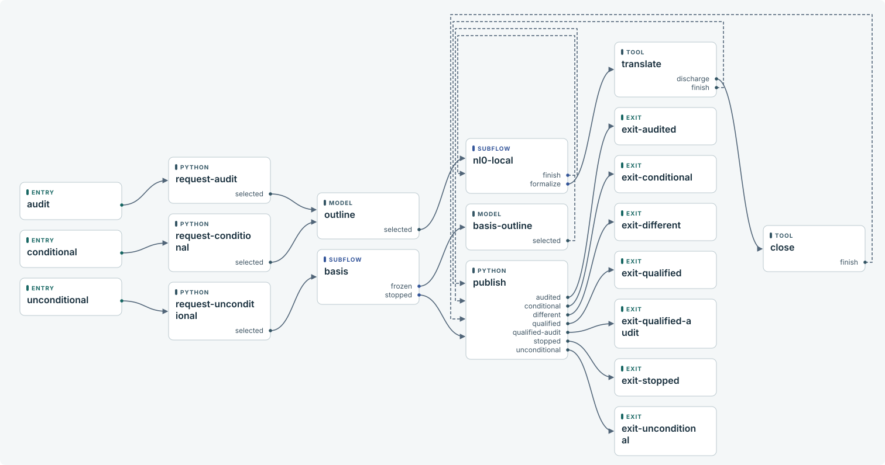

The audit entry accepts Request@1 and starts at request-audit.

The conditional entry accepts Request@1 and starts at request-conditional.

The unconditional entry accepts Request@1 and starts at request-unconditional.

The audited exit delivers Delivery@1 through publish.audited.

The conditional exit delivers Delivery@1 through publish.conditional.

The different exit delivers Delivery@1 through publish.different.

The qualified exit delivers Delivery@1 through publish.qualified.

The qualified-audit exit delivers Delivery@1 through publish.qualified-audit.

The stopped exit delivers Delivery@1 through publish.stopped.

The unconditional exit delivers Delivery@1 through publish.unconditional.

[basis](#block-basis) · [close](#block-close) · [exit-audited](#block-exit-audited) · [exit-conditional](#block-exit-conditional) · [exit-different](#block-exit-different) · [exit-qualified](#block-exit-qualified) · [exit-qualified-audit](#block-exit-qualified-audit) · [exit-stopped](#block-exit-stopped) · [exit-unconditional](#block-exit-unconditional) · [freeze-global](#block-freeze-global) · [nl0-local](#block-nl0-local) · [outline](#block-outline) · [publish](#block-publish) · [request-audit](#block-request-audit) · [request-conditional](#block-request-conditional) · [request-unconditional](#block-request-unconditional) · [translate](#block-translate)

<details><summary>Diagram connections</summary>

| From | Port or action | To |
| --- | --- | --- |
| audit | → | request-audit |
| conditional | → | request-conditional |
| unconditional | → | request-unconditional |
| basis | frozen | nl0-local |
| basis | stopped | publish |
| close | finish | publish |
| freeze-global | frozen | nl0-local |
| nl0-local | finish | publish |
| nl0-local | formalize | translate |
| outline | checked | freeze-global |
| publish | audited | exit-audited |
| publish | conditional | exit-conditional |
| publish | different | exit-different |
| publish | qualified | exit-qualified |
| publish | qualified-audit | exit-qualified-audit |
| publish | stopped | exit-stopped |
| publish | unconditional | exit-unconditional |
| request-audit | selected | outline |
| request-conditional | selected | outline |
| request-unconditional | selected | basis |
| translate | discharge | close |
| translate | finish | publish |

</details>

<a id="areas"></a>

## Functional areas

[request-audit](#block-request-audit) · [request-conditional](#block-request-conditional) · [request-unconditional](#block-request-unconditional) · [outline](#block-outline) · [basis](#block-basis) · [Inside basis](#flow-basis) · [reduce](#block-reduce) · [basis-outline](#block-basis-outline) · [freeze-global](#block-freeze-global) · [nl0-local](#block-nl0-local) · [Inside nl0-local](#flow-nl0-local) · [detail](#block-detail) · [audit](#block-audit) · [publish](#block-publish) · [translate](#block-translate) · [exit-audited](#block-exit-audited) · [exit-conditional](#block-exit-conditional) · [exit-different](#block-exit-different) · [exit-qualified](#block-exit-qualified) · [exit-qualified-audit](#block-exit-qualified-audit) · [exit-stopped](#block-exit-stopped) · [exit-unconditional](#block-exit-unconditional) · [close](#block-close)

<a id="block-request-audit"></a>

### request-audit

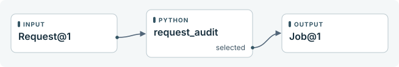

The python adapter request\_audit receives Request@1 and returns a named port and its payload.

The declared effect is pure. Interrupted work can be attempted again.

[request\_audit implementation](#handler-request_audit)

<details><summary>Diagram connections</summary>

| From | Port or action | To |
| --- | --- | --- |
| Request@1 | → | request\_audit |
| request\_audit | selected | Job@1 |

</details>

<a id="block-request-conditional"></a>

### request-conditional

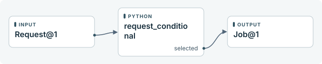

The python adapter request\_conditional receives Request@1 and returns a named port and its payload.

The declared effect is pure. Interrupted work can be attempted again.

[request\_conditional implementation](#handler-request_conditional)

<details><summary>Diagram connections</summary>

| From | Port or action | To |
| --- | --- | --- |
| Request@1 | → | request\_conditional |
| request\_conditional | selected | Job@1 |

</details>

<a id="block-request-unconditional"></a>

### request-unconditional

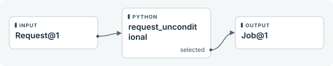

The python adapter request\_unconditional receives Request@1 and returns a named port and its payload.

The declared effect is pure. Interrupted work can be attempted again.

[request\_unconditional implementation](#handler-request_unconditional)

<details><summary>Diagram connections</summary>

| From | Port or action | To |
| --- | --- | --- |
| Request@1 | → | request\_unconditional |
| request\_unconditional | selected | Job@1 |

</details>

<a id="block-outline"></a>

### outline

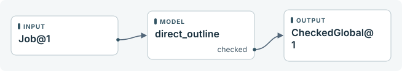

The model adapter direct\_outline receives Job@1 and returns a named port and its payload.

An uncertain external effect requires a receipt for the same operation before the run continues.

[direct\_outline implementation](#handler-direct_outline)

<details><summary>Diagram connections</summary>

| From | Port or action | To |
| --- | --- | --- |
| Job@1 | → | direct\_outline |
| direct\_outline | checked | CheckedGlobal@1 |

</details>

<a id="block-basis"></a>

### basis

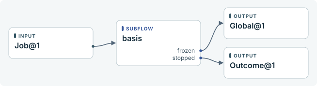

The start entry of basis receives Job@1. Its named returns select the caller's output port.

[Open the internal flow](#flow-basis)

<details><summary>Diagram connections</summary>

| From | Port or action | To |
| --- | --- | --- |
| Job@1 | → | basis |
| basis | frozen | Global@1 |
| basis | stopped | Outcome@1 |

</details>

<a id="flow-basis"></a>

### Inside basis

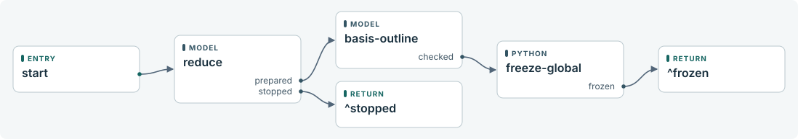

The start entry accepts Job@1 and starts at reduce.

Called at basis. Each ^port returns to the matching outcome of its caller.

[basis-outline](#block-basis-outline) · [freeze-global](#block-freeze-global) · [reduce](#block-reduce)

<details><summary>Diagram connections</summary>

| From | Port or action | To |
| --- | --- | --- |
| start | → | reduce |
| basis-outline | checked | freeze-global |
| freeze-global | frozen | ^frozen |
| reduce | prepared | basis-outline |
| reduce | stopped | ^stopped |

</details>

<a id="block-reduce"></a>

### reduce

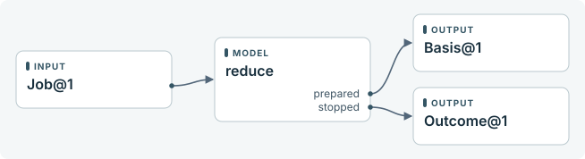

The model adapter reduce receives Job@1 and returns a named port and its payload.

An uncertain external effect requires a receipt for the same operation before the run continues.

[reduce implementation](#handler-reduce)

<details><summary>Diagram connections</summary>

| From | Port or action | To |
| --- | --- | --- |
| Job@1 | → | reduce |
| reduce | prepared | Basis@1 |
| reduce | stopped | Outcome@1 |

</details>

<a id="block-basis-outline"></a>

### basis-outline

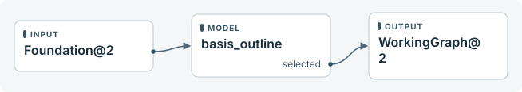

The model adapter basis\_outline receives Basis@1 and returns a named port and its payload.

An uncertain external effect requires a receipt for the same operation before the run continues.

[basis\_outline implementation](#handler-basis_outline)

<details><summary>Diagram connections</summary>

| From | Port or action | To |
| --- | --- | --- |
| Basis@1 | → | basis\_outline |
| basis\_outline | checked | CheckedGlobal@1 |

</details>

<a id="block-freeze-global"></a>

### freeze-global

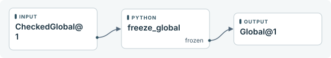

The python adapter freeze\_global receives CheckedGlobal@1 and returns a named port and its payload.

The declared effect is pure. Interrupted work can be attempted again.

[freeze\_global implementation](#handler-freeze_global)

<details><summary>Diagram connections</summary>

| From | Port or action | To |
| --- | --- | --- |
| CheckedGlobal@1 | → | freeze\_global |
| freeze\_global | frozen | Global@1 |

</details>

<a id="block-nl0-local"></a>

### nl0-local

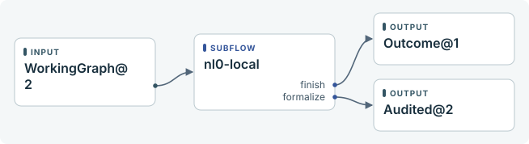

The start entry of nl0-local receives Global@1. Its named returns select the caller's output port.

[Open the internal flow](#flow-nl0-local)

<details><summary>Diagram connections</summary>

| From | Port or action | To |
| --- | --- | --- |
| Global@1 | → | nl0-local |
| nl0-local | finish | Outcome@1 |
| nl0-local | formalize | Audited@1 |

</details>

<a id="flow-nl0-local"></a>

### Inside nl0-local

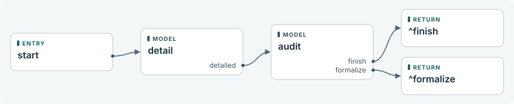

The start entry accepts Global@1 and starts at detail.

Called at nl0-local. Each ^port returns to the matching outcome of its caller.

[audit](#block-audit) · [detail](#block-detail)

<details><summary>Diagram connections</summary>

| From | Port or action | To |
| --- | --- | --- |
| start | → | detail |
| audit | finish | ^finish |
| audit | formalize | ^formalize |
| detail | detailed | audit |

</details>

<a id="block-detail"></a>

### detail

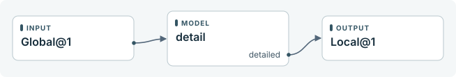

The model adapter detail receives Global@1 and returns a named port and its payload.

An uncertain external effect requires a receipt for the same operation before the run continues.

[detail implementation](#handler-detail)

<details><summary>Diagram connections</summary>

| From | Port or action | To |
| --- | --- | --- |
| Global@1 | → | detail |
| detail | detailed | Local@1 |

</details>

<a id="block-audit"></a>

### audit

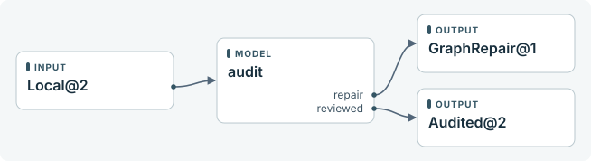

The model adapter audit receives Local@1 and returns a named port and its payload.

An uncertain external effect requires a receipt for the same operation before the run continues.

[audit implementation](#handler-audit)

<details><summary>Diagram connections</summary>

| From | Port or action | To |
| --- | --- | --- |
| Local@1 | → | audit |
| audit | finish | Outcome@1 |
| audit | formalize | Audited@1 |

</details>

<a id="block-publish"></a>

### publish

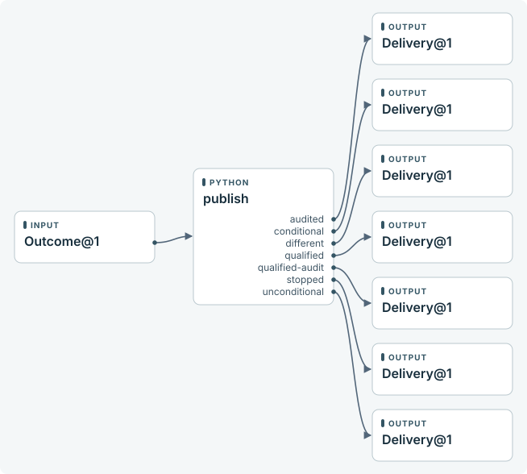

The python adapter publish receives Outcome@1 and returns a named port and its payload.

The adapter must reuse the operation ID when retrying an external effect.

[publish implementation](#handler-publish)

<details><summary>Diagram connections</summary>

| From | Port or action | To |
| --- | --- | --- |
| Outcome@1 | → | publish |
| publish | audited | Delivery@1 |
| publish | conditional | Delivery@1 |
| publish | different | Delivery@1 |
| publish | qualified | Delivery@1 |
| publish | qualified-audit | Delivery@1 |
| publish | stopped | Delivery@1 |
| publish | unconditional | Delivery@1 |

</details>

<a id="block-translate"></a>

### translate

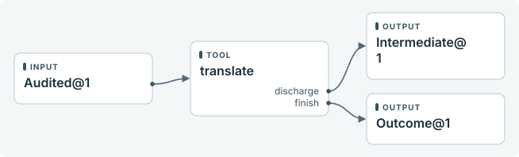

The tool adapter translate receives Audited@1 and returns a named port and its payload.

An uncertain external effect requires a receipt for the same operation before the run continues.

[translate implementation](#handler-translate)

<details><summary>Diagram connections</summary>

| From | Port or action | To |
| --- | --- | --- |
| Audited@1 | → | translate |
| translate | discharge | Intermediate@1 |
| translate | finish | Outcome@1 |

</details>

<a id="block-exit-audited"></a>

### exit-audited

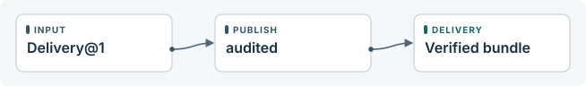

The exit publishes result.json and receipt.json for audited.

The file reference in inventory supplies the bytes for inventory.json.

<details><summary>Diagram connections</summary>

| From | Port or action | To |
| --- | --- | --- |
| Delivery@1 | → | audited |
| audited | → | Verified bundle |

</details>

<a id="block-exit-conditional"></a>

### exit-conditional

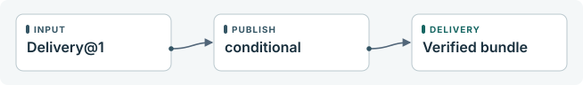

The exit publishes result.json and receipt.json for conditional.

The file reference in inventory supplies the bytes for inventory.json.

<details><summary>Diagram connections</summary>

| From | Port or action | To |
| --- | --- | --- |
| Delivery@1 | → | conditional |
| conditional | → | Verified bundle |

</details>

<a id="block-exit-different"></a>

### exit-different

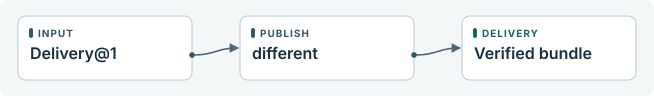

The exit publishes result.json and receipt.json for different.

The file reference in inventory supplies the bytes for inventory.json.

<details><summary>Diagram connections</summary>

| From | Port or action | To |
| --- | --- | --- |
| Delivery@1 | → | different |
| different | → | Verified bundle |

</details>

<a id="block-exit-qualified"></a>

### exit-qualified

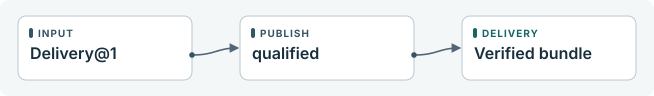

The exit publishes result.json and receipt.json for qualified.

The file reference in inventory supplies the bytes for inventory.json.

<details><summary>Diagram connections</summary>

| From | Port or action | To |
| --- | --- | --- |
| Delivery@1 | → | qualified |
| qualified | → | Verified bundle |

</details>

<a id="block-exit-qualified-audit"></a>

### exit-qualified-audit

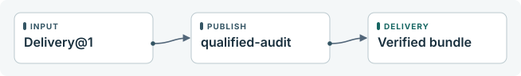

The exit publishes result.json and receipt.json for qualified-audit.

The file reference in inventory supplies the bytes for inventory.json.

<details><summary>Diagram connections</summary>

| From | Port or action | To |
| --- | --- | --- |
| Delivery@1 | → | qualified-audit |
| qualified-audit | → | Verified bundle |

</details>

<a id="block-exit-stopped"></a>

### exit-stopped


The exit publishes result.json and receipt.json for stopped.

The file reference in inventory supplies the bytes for inventory.json.

<details><summary>Diagram connections</summary>

| From | Port or action | To |
| --- | --- | --- |
| Delivery@1 | → | stopped |
| stopped | → | Verified bundle |

</details>

<a id="block-exit-unconditional"></a>

### exit-unconditional

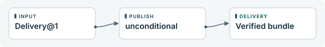

The exit publishes result.json and receipt.json for unconditional.

The file reference in inventory supplies the bytes for inventory.json.

<details><summary>Diagram connections</summary>

| From | Port or action | To |
| --- | --- | --- |
| Delivery@1 | → | unconditional |
| unconditional | → | Verified bundle |

</details>

<a id="block-close"></a>

### close

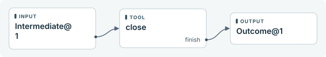

The tool adapter close receives Intermediate@1 and returns a named port and its payload.

An uncertain external effect requires a receipt for the same operation before the run continues.

[close implementation](#handler-close)

<details><summary>Diagram connections</summary>

| From | Port or action | To |
| --- | --- | --- |
| Intermediate@1 | → | close |
| close | finish | Outcome@1 |

</details>

<a id="controls"></a>

## Run controls

<a id="control-recovery"></a>

### Faults and recovery

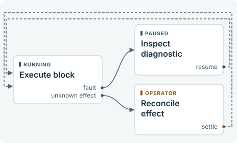

An ordinary execution fault retains its node and diagnostic. An explicit resume retries from the saved state.

For a reconcile effect, inspect the external operation and submit its actual outcome with settle and the matching operation ID.

<details><summary>Diagram connections</summary>

| From | Port or action | To |
| --- | --- | --- |
| Execute block | fault | Inspect diagnostic |
| Inspect diagnostic | resume | Execute block |
| Execute block | unknown effect | Reconcile effect |
| Reconcile effect | settle | Execute block |

</details>

<a id="control-delivery"></a>

### Delivery, cancellation and cleanup

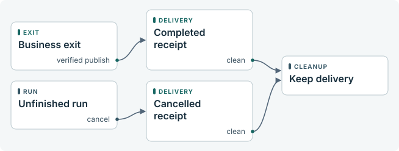

A business exit records its named result and verifies the published bundle. Cancellation of unfinished work records its own receipt. An already published delivery is recovered if cancellation races with its final commit.

Explicit clean cancels unfinished work, verifies delivery, and removes owned working files. The delivery command can verify the retained bundle afterwards.

<details><summary>Diagram connections</summary>

| From | Port or action | To |
| --- | --- | --- |
| Business exit | verified publish | Completed receipt |
| Unfinished run | cancel | Cancelled receipt |
| Completed receipt | clean | Keep delivery |
| Cancelled receipt | clean | Keep delivery |

</details>

<a id="reference"></a>

## Technical reference

Each run pins its workflow, adapters and runtime. This guide describes the source definition identified below. Receipt status, observed paths and usage belong to individual runs.

<a id="handoffs"></a>

### Resolved handoffs

Each row is one executable outcome. Instance paths distinguish repeated calls to the same subflow. Both ends use the named contract.

| Producer | Outcome | Receiver | Contract |
| --- | --- | --- | --- |
| basis/@enter | enter | basis/reduce | Job@1 |
| basis/basis-outline | checked | basis/freeze-global | CheckedGlobal@1 |
| basis/freeze-global | frozen | nl0-local/@enter | Global@1 |
| basis/reduce | prepared | basis/basis-outline | Basis@1 |
| basis/reduce | stopped | publish | Outcome@1 |
| close | finish | publish | Outcome@1 |
| freeze-global | frozen | nl0-local/@enter | Global@1 |
| nl0-local/@enter | enter | nl0-local/detail | Global@1 |
| nl0-local/audit | finish | publish | Outcome@1 |
| nl0-local/audit | formalize | translate | Audited@1 |
| nl0-local/detail | detailed | nl0-local/audit | Local@1 |
| outline | checked | freeze-global | CheckedGlobal@1 |
| publish | audited | exit-audited | Delivery@1 |
| publish | conditional | exit-conditional | Delivery@1 |
| publish | different | exit-different | Delivery@1 |
| publish | qualified | exit-qualified | Delivery@1 |
| publish | qualified-audit | exit-qualified-audit | Delivery@1 |
| publish | stopped | exit-stopped | Delivery@1 |
| publish | unconditional | exit-unconditional | Delivery@1 |
| request-audit | selected | outline | Job@1 |
| request-conditional | selected | outline | Job@1 |
| request-unconditional | selected | basis/@enter | Job@1 |
| translate | discharge | close | Intermediate@1 |
| translate | finish | publish | Outcome@1 |

<a id="contracts"></a>

### Contract definitions

<a id="contract-Audited@1"></a>

#### Audited@1

```json
{
  "additionalProperties": false,
  "properties": {
    "authority": {
      "$ref": "urn:workflow:Binding@1"
    },
    "global": {
      "$ref": "urn:workflow:Binding@1"
    },
    "goal": {
      "enum": [
        "audit",
        "conditional",
        "unconditional"
      ]
    },
    "job": {
      "$ref": "urn:workflow:Binding@1"
    }
  },
  "required": [
    "job",
    "goal",
    "global",
    "authority"
  ],
  "type": "object"
}
```

<a id="contract-Basis@1"></a>

#### Basis@1

```json
{
  "additionalProperties": false,
  "properties": {
    "basis": {
      "$ref": "urn:workflow:Binding@1"
    },
    "goal": {
      "enum": [
        "audit",
        "conditional",
        "unconditional"
      ]
    },
    "job": {
      "$ref": "urn:workflow:Binding@1"
    }
  },
  "required": [
    "job",
    "goal",
    "basis"
  ],
  "type": "object"
}
```

<a id="contract-Binding@1"></a>

#### Binding@1

```json
{
  "additionalProperties": false,
  "properties": {
    "path": {
      "minLength": 1,
      "type": "string"
    },
    "sha256": {
      "pattern": "^[0-9a-f]{64}$",
      "type": "string"
    }
  },
  "required": [
    "path",
    "sha256"
  ],
  "type": "object"
}
```

<a id="contract-CheckedGlobal@1"></a>

#### CheckedGlobal@1

```json
{
  "additionalProperties": false,
  "properties": {
    "global": {
      "$ref": "urn:workflow:Binding@1"
    },
    "goal": {
      "enum": [
        "audit",
        "conditional",
        "unconditional"
      ]
    },
    "job": {
      "$ref": "urn:workflow:Binding@1"
    }
  },
  "required": [
    "job",
    "goal",
    "global"
  ],
  "type": "object"
}
```

<a id="contract-Delivery@1"></a>

#### Delivery@1

```json
{
  "additionalProperties": false,
  "properties": {
    "extra_premises": {
      "items": {
        "minLength": 1,
        "type": "string"
      },
      "type": "array",
      "uniqueItems": true
    },
    "inventory": {
      "$ref": "urn:workflow:blob@1"
    },
    "scope": {
      "minLength": 1,
      "type": "string"
    }
  },
  "required": [
    "scope",
    "extra_premises",
    "inventory"
  ],
  "type": "object"
}
```

<a id="contract-Global@1"></a>

#### Global@1

```json
{
  "additionalProperties": false,
  "properties": {
    "global": {
      "$ref": "urn:workflow:Binding@1"
    },
    "goal": {
      "enum": [
        "audit",
        "conditional",
        "unconditional"
      ]
    },
    "job": {
      "$ref": "urn:workflow:Binding@1"
    }
  },
  "required": [
    "job",
    "goal",
    "global"
  ],
  "type": "object"
}
```

<a id="contract-Intermediate@1"></a>

#### Intermediate@1

```json
{
  "additionalProperties": false,
  "properties": {
    "authority": {
      "$ref": "urn:workflow:Binding@1"
    },
    "global": {
      "$ref": "urn:workflow:Binding@1"
    },
    "goal": {
      "enum": [
        "audit",
        "conditional",
        "unconditional"
      ]
    },
    "intermediate": {
      "$ref": "urn:workflow:Binding@1"
    },
    "job": {
      "$ref": "urn:workflow:Binding@1"
    }
  },
  "required": [
    "job",
    "goal",
    "global",
    "authority",
    "intermediate"
  ],
  "type": "object"
}
```

<a id="contract-Job@1"></a>

#### Job@1

```json
{
  "additionalProperties": false,
  "properties": {
    "goal": {
      "enum": [
        "audit",
        "conditional",
        "unconditional"
      ]
    },
    "job": {
      "$ref": "urn:workflow:Binding@1"
    }
  },
  "required": [
    "job",
    "goal"
  ],
  "type": "object"
}
```

<a id="contract-Local@1"></a>

#### Local@1

```json
{
  "additionalProperties": false,
  "properties": {
    "global": {
      "$ref": "urn:workflow:Binding@1"
    },
    "goal": {
      "enum": [
        "audit",
        "conditional",
        "unconditional"
      ]
    },
    "job": {
      "$ref": "urn:workflow:Binding@1"
    },
    "local": {
      "$ref": "urn:workflow:Binding@1"
    }
  },
  "required": [
    "job",
    "goal",
    "global",
    "local"
  ],
  "type": "object"
}
```

<a id="contract-Outcome@1"></a>

#### Outcome@1

```json
{
  "additionalProperties": false,
  "properties": {
    "goal": {
      "enum": [
        "audit",
        "conditional",
        "unconditional"
      ]
    },
    "job": {
      "$ref": "urn:workflow:Binding@1"
    },
    "outcome": {
      "$ref": "urn:workflow:Binding@1"
    }
  },
  "required": [
    "job",
    "goal",
    "outcome"
  ],
  "type": "object"
}
```

<a id="contract-Request@1"></a>

#### Request@1

```json
{
  "additionalProperties": false,
  "properties": {
    "job": {
      "$ref": "urn:workflow:Binding@1"
    }
  },
  "required": [
    "job"
  ],
  "type": "object"
}
```

<a id="contract-blob@1"></a>

#### blob@1

```json
{
  "additionalProperties": false,
  "properties": {
    "sha256": {
      "pattern": "^[a-f0-9]{64}$",
      "type": "string"
    },
    "size": {
      "minimum": 0,
      "type": "integer"
    }
  },
  "required": [
    "sha256",
    "size"
  ],
  "type": "object"
}
```

<a id="handlers"></a>

### Handler implementations

Python excerpts and docstrings come from this checkout. Model reasoning, remote services and dynamically bound implementations are opaque to static inspection.

<a id="handler-audit"></a>

#### audit

adapters.py · line 24

```python
def audit(ctx, data): return dispatch(ctx, data, 'audit')
```

<a id="handler-basis_outline"></a>

#### basis\_outline

adapters.py · line 21

```python
def basis_outline(ctx, data): return dispatch(ctx, data, 'basis_outline')
```

<a id="handler-close"></a>

#### close

adapters.py · line 26

```python
def close(ctx, data): return dispatch(ctx, data, 'close')
```

<a id="handler-detail"></a>

#### detail

adapters.py · line 23

```python
def detail(ctx, data): return dispatch(ctx, data, 'detail')
```

<a id="handler-direct_outline"></a>

#### direct\_outline

adapters.py · line 20

```python
def direct_outline(ctx, data): return dispatch(ctx, data, 'direct_outline')
```

<a id="handler-freeze_global"></a>

#### freeze\_global

adapters.py · line 22

```python
def freeze_global(ctx, data): return dispatch(ctx, data, 'freeze_global')
```

<a id="handler-publish"></a>

#### publish

adapters.py · line 27

```python
def publish(ctx, data): return dispatch(ctx, data, 'publish')
```

<a id="handler-reduce"></a>

#### reduce

adapters.py · line 19

```python
def reduce(ctx, data): return dispatch(ctx, data, 'reduce')
```

<a id="handler-request_audit"></a>

#### request\_audit

adapters.py · line 16

```python
def request_audit(ctx, data): return dispatch(ctx, data, 'request_audit')
```

<a id="handler-request_conditional"></a>

#### request\_conditional

adapters.py · line 17

```python
def request_conditional(ctx, data): return dispatch(ctx, data, 'request_conditional')
```

<a id="handler-request_unconditional"></a>

#### request\_unconditional

adapters.py · line 18

```python
def request_unconditional(ctx, data): return dispatch(ctx, data, 'request_unconditional')
```

<a id="handler-translate"></a>

#### translate

adapters.py · line 25

```python
def translate(ctx, data): return dispatch(ctx, data, 'translate')
```

Workflow protocol 1 · Definition 515be9e26fba083416c00b890106445703626afca93033f982a4bc6c8fbdc36c
