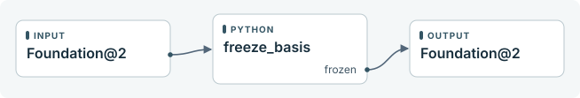
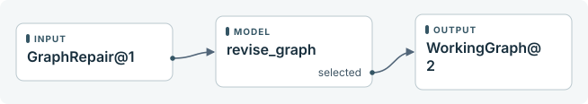
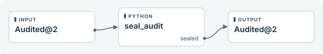
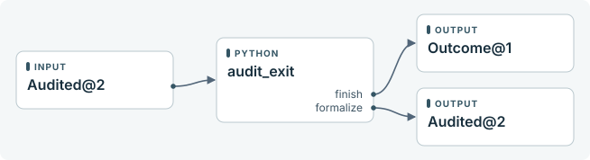

<a id="guide"></a>

# Yui workflow

Turn an existing mathematical proof into an independently audited NL0 graph or a verified Lean proof.

[Overview](#overview) · [Functional areas](#areas) · [Run controls](#controls) · [Technical reference](#reference)

<a id="overview"></a>

## Overview


The audit entry accepts Request@1 and starts at request-audit.

The conditional entry accepts Request@1 and starts at request-conditional.

The unconditional entry accepts Request@1 and starts at request-unconditional.

The audited exit delivers Delivery@1 through publish.audited.

The conditional exit delivers Delivery@1 through publish.conditional.

The different exit delivers Delivery@1 through publish.different.

The qualified exit delivers Delivery@1 through publish.qualified.

The qualified-audit exit delivers Delivery@1 through publish.qualified-audit.

The stopped exit delivers Delivery@1 through publish.stopped.

The unconditional exit delivers Delivery@1 through publish.unconditional.

[basis](#block-basis) · [basis-outline](#block-basis-outline) · [close](#block-close) · [exit-audited](#block-exit-audited) · [exit-conditional](#block-exit-conditional) · [exit-different](#block-exit-different) · [exit-qualified](#block-exit-qualified) · [exit-qualified-audit](#block-exit-qualified-audit) · [exit-stopped](#block-exit-stopped) · [exit-unconditional](#block-exit-unconditional) · [nl0-local](#block-nl0-local) · [outline](#block-outline) · [publish](#block-publish) · [request-audit](#block-request-audit) · [request-conditional](#block-request-conditional) · [request-unconditional](#block-request-unconditional) · [translate](#block-translate)

<details><summary>Diagram connections</summary>

| From | Port or action | To |
| --- | --- | --- |
| audit | → | request-audit |
| conditional | → | request-conditional |
| unconditional | → | request-unconditional |
| basis | frozen | basis-outline |
| basis | stopped | publish |
| basis-outline | selected | nl0-local |
| close | finish | publish |
| nl0-local | finish | publish |
| nl0-local | formalize | translate |
| outline | selected | nl0-local |
| publish | audited | exit-audited |
| publish | conditional | exit-conditional |
| publish | different | exit-different |
| publish | qualified | exit-qualified |
| publish | qualified-audit | exit-qualified-audit |
| publish | stopped | exit-stopped |
| publish | unconditional | exit-unconditional |
| request-audit | selected | outline |
| request-conditional | selected | outline |
| request-unconditional | selected | basis |
| translate | discharge | close |
| translate | finish | publish |

</details>

<a id="areas"></a>

## Functional areas

[request-audit](#block-request-audit) · [request-conditional](#block-request-conditional) · [request-unconditional](#block-request-unconditional) · [outline](#block-outline) · [basis](#block-basis) · [Inside basis](#flow-basis) · [reduce](#block-reduce) · [freeze-basis](#block-freeze-basis) · [nl0-local](#block-nl0-local) · [Inside nl0-local](#flow-nl0-local) · [detail](#block-detail) · [audit](#block-audit) · [revise-graph](#block-revise-graph) · [seal-audit](#block-seal-audit) · [audit-exit](#block-audit-exit) · [basis-outline](#block-basis-outline) · [publish](#block-publish) · [translate](#block-translate) · [exit-audited](#block-exit-audited) · [exit-conditional](#block-exit-conditional) · [exit-different](#block-exit-different) · [exit-qualified](#block-exit-qualified) · [exit-qualified-audit](#block-exit-qualified-audit) · [exit-stopped](#block-exit-stopped) · [exit-unconditional](#block-exit-unconditional) · [close](#block-close)

<a id="block-request-audit"></a>

### request-audit


The python adapter request\_audit receives Request@1 and returns a named port and its payload.

The declared effect is pure. Interrupted work can be attempted again.

[request\_audit implementation](#handler-request_audit)

<details><summary>Diagram connections</summary>

| From | Port or action | To |
| --- | --- | --- |
| Request@1 | → | request\_audit |
| request\_audit | selected | Job@1 |

</details>

<a id="block-request-conditional"></a>

### request-conditional


The python adapter request\_conditional receives Request@1 and returns a named port and its payload.

The declared effect is pure. Interrupted work can be attempted again.

[request\_conditional implementation](#handler-request_conditional)

<details><summary>Diagram connections</summary>

| From | Port or action | To |
| --- | --- | --- |
| Request@1 | → | request\_conditional |
| request\_conditional | selected | Job@1 |

</details>

<a id="block-request-unconditional"></a>

### request-unconditional


The python adapter request\_unconditional receives Request@1 and returns a named port and its payload.

The declared effect is pure. Interrupted work can be attempted again.

[request\_unconditional implementation](#handler-request_unconditional)

<details><summary>Diagram connections</summary>

| From | Port or action | To |
| --- | --- | --- |
| Request@1 | → | request\_unconditional |
| request\_unconditional | selected | Job@1 |

</details>

<a id="block-outline"></a>

### outline


The model adapter direct\_outline receives Job@1 and returns a named port and its payload.

An uncertain external effect requires a receipt for the same operation before the run continues.

Construct the first working graph from the original proof.

[direct\_outline implementation](#handler-direct_outline)

<details><summary>Diagram connections</summary>

| From | Port or action | To |
| --- | --- | --- |
| Job@1 | → | direct\_outline |
| direct\_outline | selected | WorkingGraph@2 |

</details>

<a id="block-basis"></a>

### basis


The start entry of basis receives Job@1. Its named returns select the caller's output port.

[Open the internal flow](#flow-basis)

<details><summary>Diagram connections</summary>

| From | Port or action | To |
| --- | --- | --- |
| Job@1 | → | basis |
| basis | frozen | Foundation@2 |
| basis | stopped | Outcome@1 |

</details>

<a id="flow-basis"></a>

### Inside basis


The start entry accepts Job@1 and starts at reduce.

Called at basis. Each ^port returns to the matching outcome of its caller.

[freeze-basis](#block-freeze-basis) · [reduce](#block-reduce)

<details><summary>Diagram connections</summary>

| From | Port or action | To |
| --- | --- | --- |
| start | → | reduce |
| freeze-basis | frozen | ^frozen |
| reduce | prepared | freeze-basis |
| reduce | stopped | ^stopped |

</details>

<a id="block-reduce"></a>

### reduce


The model adapter reduce receives Job@1 and returns a named port and its payload.

An uncertain external effect requires a receipt for the same operation before the run continues.

Select and check foundations. An author may consult the optional basis catalog while choosing the route.

[reduce implementation](#handler-reduce)

<details><summary>Diagram connections</summary>

| From | Port or action | To |
| --- | --- | --- |
| Job@1 | → | reduce |
| reduce | prepared | Foundation@2 |
| reduce | stopped | Outcome@1 |

</details>

<a id="block-freeze-basis"></a>

### freeze-basis



The python adapter freeze\_basis receives Foundation@2 and returns a named port and its payload.

The adapter must reuse the operation ID when retrying an external effect.

Pin the reviewed mathematical foundations and honor the optional 2basis checkpoint.

[freeze\_basis implementation](#handler-freeze_basis)

<details><summary>Diagram connections</summary>

| From | Port or action | To |
| --- | --- | --- |
| Foundation@2 | → | freeze\_basis |
| freeze\_basis | frozen | Foundation@2 |

</details>

<a id="block-nl0-local"></a>

### nl0-local


The start entry of nl0-local receives WorkingGraph@2. Its named returns select the caller's output port.

[Open the internal flow](#flow-nl0-local)

<details><summary>Diagram connections</summary>

| From | Port or action | To |
| --- | --- | --- |
| WorkingGraph@2 | → | nl0-local |
| nl0-local | finish | Outcome@1 |
| nl0-local | formalize | Audited@2 |

</details>

<a id="flow-nl0-local"></a>

### Inside nl0-local


The start entry accepts WorkingGraph@2 and starts at detail.

Called at nl0-local. Each ^port returns to the matching outcome of its caller.

[audit](#block-audit) · [audit-exit](#block-audit-exit) · [detail](#block-detail) · [revise-graph](#block-revise-graph) · [seal-audit](#block-seal-audit)

<details><summary>Diagram connections</summary>

| From | Port or action | To |
| --- | --- | --- |
| start | → | detail |
| audit | repair | revise-graph |
| audit | reviewed | seal-audit |
| audit-exit | finish | ^finish |
| audit-exit | formalize | ^formalize |
| detail | detailed | audit |
| detail | repair | revise-graph |
| revise-graph | selected | detail |
| seal-audit | sealed | audit-exit |

</details>

<a id="block-detail"></a>

### detail


The model adapter detail receives WorkingGraph@2 and returns a named port and its payload.

An uncertain external effect requires a receipt for the same operation before the run continues.

Fill the inference bodies or report a located defect in the assigned graph.

[detail implementation](#handler-detail)

<details><summary>Diagram connections</summary>

| From | Port or action | To |
| --- | --- | --- |
| WorkingGraph@2 | → | detail |
| detail | detailed | Local@2 |
| detail | repair | GraphRepair@1 |

</details>

<a id="block-audit"></a>

### audit


The model adapter audit receives Local@2 and returns a named port and its payload.

An uncertain external effect requires a receipt for the same operation before the run continues.

Independently review the complete current NL0 and route located graph findings.

[audit implementation](#handler-audit)

<details><summary>Diagram connections</summary>

| From | Port or action | To |
| --- | --- | --- |
| Local@2 | → | audit |
| audit | repair | GraphRepair@1 |
| audit | reviewed | Audited@2 |

</details>

<a id="block-revise-graph"></a>

### revise-graph



The model adapter revise\_graph receives GraphRepair@1 and returns a named port and its payload.

An uncertain external effect requires a receipt for the same operation before the run continues.

Give the located finding to the global author. Validate revised labels and every consumer against the same frozen foundations.

nl0-local/revise-graph pauses when visits exceed 8.

[revise\_graph implementation](#handler-revise_graph)

<details><summary>Diagram connections</summary>

| From | Port or action | To |
| --- | --- | --- |
| GraphRepair@1 | → | revise\_graph |
| revise\_graph | selected | WorkingGraph@2 |

</details>

<a id="block-seal-audit"></a>

### seal-audit



The python adapter seal\_audit receives Audited@2 and returns a named port and its payload.

The adapter must reuse the operation ID when retrying an external effect.

Verify the exact graph, specification and Audit A evidence at the selected revision.

[seal\_audit implementation](#handler-seal_audit)

<details><summary>Diagram connections</summary>

| From | Port or action | To |
| --- | --- | --- |
| Audited@2 | → | seal\_audit |
| seal\_audit | sealed | Audited@2 |

</details>

<a id="block-audit-exit"></a>

### audit-exit



The python adapter audit\_exit receives Audited@2 and returns a named port and its payload.

The adapter must reuse the operation ID when retrying an external effect.

Deliver the audited NL0 or pass its sealed authority to Lean.

[audit\_exit implementation](#handler-audit_exit)

<details><summary>Diagram connections</summary>

| From | Port or action | To |
| --- | --- | --- |
| Audited@2 | → | audit\_exit |
| audit\_exit | finish | Outcome@1 |
| audit\_exit | formalize | Audited@2 |

</details>

<a id="block-basis-outline"></a>

### basis-outline


The model adapter basis\_outline receives Foundation@2 and returns a named port and its payload.

An uncertain external effect requires a receipt for the same operation before the run continues.

Assign one M/E label per directly used frozen foundation and stage the numbered graph for NL0.

[basis\_outline implementation](#handler-basis_outline)

<details><summary>Diagram connections</summary>

| From | Port or action | To |
| --- | --- | --- |
| Foundation@2 | → | basis\_outline |
| basis\_outline | selected | WorkingGraph@2 |

</details>

<a id="block-publish"></a>

### publish


The python adapter publish receives Outcome@1 and returns a named port and its payload.

The adapter must reuse the operation ID when retrying an external effect.

[publish implementation](#handler-publish)

<details><summary>Diagram connections</summary>

| From | Port or action | To |
| --- | --- | --- |
| Outcome@1 | → | publish |
| publish | audited | Delivery@1 |
| publish | conditional | Delivery@1 |
| publish | different | Delivery@1 |
| publish | qualified | Delivery@1 |
| publish | qualified-audit | Delivery@1 |
| publish | stopped | Delivery@1 |
| publish | unconditional | Delivery@1 |

</details>

<a id="block-translate"></a>

### translate


The tool adapter translate receives Audited@2 and returns a named port and its payload.

An uncertain external effect requires a receipt for the same operation before the run continues.

Authors may consult strategy cards. Check helper declarations incrementally, compile the combined proof and audit the export.  Every native wall timeout receives a source-located diagnosis. Local checks start at six minutes and rise by six to thirty only for workload findings. Complete-file assembly/export/inspection and final basis closure start at thirty minutes and rise by fifteen to sixty. Code repair retains its current allowance; partial output from a timed-out check cannot pass acceptance. A complete local round may retain GRAPH\_ASSEMBLY\_REPAIR\_REQUIRED while selection, reading and assembly preparation pass its exact bound files to connection repair. Incomplete rounds remain available to diagnosis/reuse under their own gates. Final acceptance requires actual compiled evidence.

[translate implementation](#handler-translate)

<details><summary>Diagram connections</summary>

| From | Port or action | To |
| --- | --- | --- |
| Audited@2 | → | translate |
| translate | discharge | Intermediate@1 |
| translate | finish | Outcome@1 |

</details>

<a id="block-exit-audited"></a>

### exit-audited


The exit publishes result.json and receipt.json for audited.

The file reference in inventory supplies the bytes for inventory.json.

<details><summary>Diagram connections</summary>

| From | Port or action | To |
| --- | --- | --- |
| Delivery@1 | → | audited |
| audited | → | Verified bundle |

</details>

<a id="block-exit-conditional"></a>

### exit-conditional


The exit publishes result.json and receipt.json for conditional.

The file reference in inventory supplies the bytes for inventory.json.

<details><summary>Diagram connections</summary>

| From | Port or action | To |
| --- | --- | --- |
| Delivery@1 | → | conditional |
| conditional | → | Verified bundle |

</details>

<a id="block-exit-different"></a>

### exit-different


The exit publishes result.json and receipt.json for different.

The file reference in inventory supplies the bytes for inventory.json.

<details><summary>Diagram connections</summary>

| From | Port or action | To |
| --- | --- | --- |
| Delivery@1 | → | different |
| different | → | Verified bundle |

</details>

<a id="block-exit-qualified"></a>

### exit-qualified


The exit publishes result.json and receipt.json for qualified.

The file reference in inventory supplies the bytes for inventory.json.

<details><summary>Diagram connections</summary>

| From | Port or action | To |
| --- | --- | --- |
| Delivery@1 | → | qualified |
| qualified | → | Verified bundle |

</details>

<a id="block-exit-qualified-audit"></a>

### exit-qualified-audit


The exit publishes result.json and receipt.json for qualified-audit.

The file reference in inventory supplies the bytes for inventory.json.

<details><summary>Diagram connections</summary>

| From | Port or action | To |
| --- | --- | --- |
| Delivery@1 | → | qualified-audit |
| qualified-audit | → | Verified bundle |

</details>

<a id="block-exit-stopped"></a>

### exit-stopped


The exit publishes result.json and receipt.json for stopped.

The file reference in inventory supplies the bytes for inventory.json.

<details><summary>Diagram connections</summary>

| From | Port or action | To |
| --- | --- | --- |
| Delivery@1 | → | stopped |
| stopped | → | Verified bundle |

</details>

<a id="block-exit-unconditional"></a>

### exit-unconditional


The exit publishes result.json and receipt.json for unconditional.

The file reference in inventory supplies the bytes for inventory.json.

<details><summary>Diagram connections</summary>

| From | Port or action | To |
| --- | --- | --- |
| Delivery@1 | → | unconditional |
| unconditional | → | Verified bundle |

</details>

<a id="block-close"></a>

### close


The tool adapter close receives Intermediate@1 and returns a named port and its payload.

An uncertain external effect requires a receipt for the same operation before the run continues.

[close implementation](#handler-close)

<details><summary>Diagram connections</summary>

| From | Port or action | To |
| --- | --- | --- |
| Intermediate@1 | → | close |
| close | finish | Outcome@1 |

</details>

<a id="controls"></a>

## Run controls

<a id="control-recovery"></a>

### Faults and recovery


An ordinary execution fault retains its node and diagnostic. An explicit resume retries from the saved state.

For a reconcile effect, inspect the external operation and submit its actual outcome with settle and the matching operation ID.

A visit limit also pauses execution. Resuming the same over-budget activation keeps that limit in force.

<details><summary>Diagram connections</summary>

| From | Port or action | To |
| --- | --- | --- |
| Execute block | fault | Inspect diagnostic |
| Inspect diagnostic | resume | Execute block |
| Execute block | unknown effect | Reconcile effect |
| Reconcile effect | settle | Execute block |

</details>

<a id="control-delivery"></a>

### Delivery, cancellation and cleanup


A business exit records its named result and verifies the published bundle. Cancellation of unfinished work records its own receipt. An already published delivery is recovered if cancellation races with its final commit.

Explicit clean cancels unfinished work, verifies delivery, and removes owned working files. The delivery command can verify the retained bundle afterwards.

<details><summary>Diagram connections</summary>

| From | Port or action | To |
| --- | --- | --- |
| Business exit | verified publish | Completed receipt |
| Unfinished run | cancel | Cancelled receipt |
| Completed receipt | clean | Keep delivery |
| Cancelled receipt | clean | Keep delivery |

</details>

<a id="reference"></a>

## Technical reference

Each run pins its workflow, adapters and runtime. This guide describes the source definition identified below. Receipt status, observed paths and usage belong to individual runs.

<a id="handoffs"></a>

### Resolved handoffs

Each row is one executable outcome. Instance paths distinguish repeated calls to the same subflow. Both ends use the named contract.

| Producer | Outcome | Receiver | Contract |
| --- | --- | --- | --- |
| basis-outline | selected | nl0-local/@enter | WorkingGraph@2 |
| basis/@enter | enter | basis/reduce | Job@1 |
| basis/freeze-basis | frozen | basis-outline | Foundation@2 |
| basis/reduce | prepared | basis/freeze-basis | Foundation@2 |
| basis/reduce | stopped | publish | Outcome@1 |
| close | finish | publish | Outcome@1 |
| nl0-local/@enter | enter | nl0-local/detail | WorkingGraph@2 |
| nl0-local/audit | repair | nl0-local/revise-graph | GraphRepair@1 |
| nl0-local/audit | reviewed | nl0-local/seal-audit | Audited@2 |
| nl0-local/audit-exit | finish | publish | Outcome@1 |
| nl0-local/audit-exit | formalize | translate | Audited@2 |
| nl0-local/detail | detailed | nl0-local/audit | Local@2 |
| nl0-local/detail | repair | nl0-local/revise-graph | GraphRepair@1 |
| nl0-local/revise-graph | selected | nl0-local/detail | WorkingGraph@2 |
| nl0-local/seal-audit | sealed | nl0-local/audit-exit | Audited@2 |
| outline | selected | nl0-local/@enter | WorkingGraph@2 |
| publish | audited | exit-audited | Delivery@1 |
| publish | conditional | exit-conditional | Delivery@1 |
| publish | different | exit-different | Delivery@1 |
| publish | qualified | exit-qualified | Delivery@1 |
| publish | qualified-audit | exit-qualified-audit | Delivery@1 |
| publish | stopped | exit-stopped | Delivery@1 |
| publish | unconditional | exit-unconditional | Delivery@1 |
| request-audit | selected | outline | Job@1 |
| request-conditional | selected | outline | Job@1 |
| request-unconditional | selected | basis/@enter | Job@1 |
| translate | discharge | close | Intermediate@1 |
| translate | finish | publish | Outcome@1 |

<a id="contracts"></a>

### Contract definitions

<a id="contract-Audited@2"></a>

#### Audited@2

```json
{
  "additionalProperties": false,
  "properties": {
    "authority": {
      "$ref": "urn:workflow:Binding@1"
    },
    "global": {
      "$ref": "urn:workflow:Binding@1"
    },
    "goal": {
      "enum": [
        "audit",
        "conditional",
        "unconditional"
      ]
    },
    "job": {
      "$ref": "urn:workflow:Binding@1"
    }
  },
  "required": [
    "job",
    "goal",
    "global",
    "authority"
  ],
  "type": "object"
}
```

<a id="contract-Binding@1"></a>

#### Binding@1

```json
{
  "additionalProperties": false,
  "properties": {
    "path": {
      "minLength": 1,
      "type": "string"
    },
    "sha256": {
      "pattern": "^[0-9a-f]{64}$",
      "type": "string"
    }
  },
  "required": [
    "path",
    "sha256"
  ],
  "type": "object"
}
```

<a id="contract-Delivery@1"></a>

#### Delivery@1

```json
{
  "additionalProperties": false,
  "properties": {
    "extra_premises": {
      "items": {
        "minLength": 1,
        "type": "string"
      },
      "type": "array",
      "uniqueItems": true
    },
    "inventory": {
      "$ref": "urn:workflow:blob@1"
    },
    "scope": {
      "minLength": 1,
      "type": "string"
    }
  },
  "required": [
    "scope",
    "extra_premises",
    "inventory"
  ],
  "type": "object"
}
```

<a id="contract-Foundation@2"></a>

#### Foundation@2

```json
{
  "additionalProperties": false,
  "properties": {
    "basis": {
      "$ref": "urn:workflow:Binding@1"
    },
    "goal": {
      "enum": [
        "audit",
        "conditional",
        "unconditional"
      ]
    },
    "job": {
      "$ref": "urn:workflow:Binding@1"
    }
  },
  "required": [
    "job",
    "goal",
    "basis"
  ],
  "type": "object"
}
```

<a id="contract-GraphRepair@1"></a>

#### GraphRepair@1

```json
{
  "additionalProperties": false,
  "properties": {
    "global": {
      "$ref": "urn:workflow:Binding@1"
    },
    "goal": {
      "enum": [
        "audit",
        "conditional",
        "unconditional"
      ]
    },
    "job": {
      "$ref": "urn:workflow:Binding@1"
    },
    "repair": {
      "$ref": "urn:workflow:Binding@1"
    }
  },
  "required": [
    "job",
    "goal",
    "global",
    "repair"
  ],
  "type": "object"
}
```

<a id="contract-Intermediate@1"></a>

#### Intermediate@1

```json
{
  "additionalProperties": false,
  "properties": {
    "authority": {
      "$ref": "urn:workflow:Binding@1"
    },
    "global": {
      "$ref": "urn:workflow:Binding@1"
    },
    "goal": {
      "enum": [
        "audit",
        "conditional",
        "unconditional"
      ]
    },
    "intermediate": {
      "$ref": "urn:workflow:Binding@1"
    },
    "job": {
      "$ref": "urn:workflow:Binding@1"
    }
  },
  "required": [
    "job",
    "goal",
    "global",
    "authority",
    "intermediate"
  ],
  "type": "object"
}
```

<a id="contract-Job@1"></a>

#### Job@1

```json
{
  "additionalProperties": false,
  "properties": {
    "goal": {
      "enum": [
        "audit",
        "conditional",
        "unconditional"
      ]
    },
    "job": {
      "$ref": "urn:workflow:Binding@1"
    }
  },
  "required": [
    "job",
    "goal"
  ],
  "type": "object"
}
```

<a id="contract-Local@2"></a>

#### Local@2

```json
{
  "additionalProperties": false,
  "properties": {
    "global": {
      "$ref": "urn:workflow:Binding@1"
    },
    "goal": {
      "enum": [
        "audit",
        "conditional",
        "unconditional"
      ]
    },
    "history": {
      "$ref": "urn:workflow:Binding@1"
    },
    "job": {
      "$ref": "urn:workflow:Binding@1"
    },
    "local": {
      "$ref": "urn:workflow:Binding@1"
    }
  },
  "required": [
    "job",
    "goal",
    "global",
    "local"
  ],
  "type": "object"
}
```

<a id="contract-Outcome@1"></a>

#### Outcome@1

```json
{
  "additionalProperties": false,
  "properties": {
    "goal": {
      "enum": [
        "audit",
        "conditional",
        "unconditional"
      ]
    },
    "job": {
      "$ref": "urn:workflow:Binding@1"
    },
    "outcome": {
      "$ref": "urn:workflow:Binding@1"
    }
  },
  "required": [
    "job",
    "goal",
    "outcome"
  ],
  "type": "object"
}
```

<a id="contract-Request@1"></a>

#### Request@1

```json
{
  "additionalProperties": false,
  "properties": {
    "job": {
      "$ref": "urn:workflow:Binding@1"
    }
  },
  "required": [
    "job"
  ],
  "type": "object"
}
```

<a id="contract-StrategyQuery@1"></a>

#### StrategyQuery@1

```json
{
  "additionalProperties": false,
  "properties": {
    "bank": {
      "enum": [
        "basis",
        "lean"
      ],
      "type": "string"
    },
    "ids": {
      "items": {
        "pattern": "^ST[0-9]{3,}$",
        "type": "string"
      },
      "maxItems": 3,
      "type": "array",
      "uniqueItems": true
    }
  },
  "required": [
    "bank"
  ],
  "type": "object"
}
```

<a id="contract-StrategyReply@1"></a>

#### StrategyReply@1

```json
{
  "anyOf": [
    {
      "additionalProperties": false,
      "properties": {
        "bank": {
          "enum": [
            "basis",
            "lean"
          ],
          "type": "string"
        },
        "catalog": {
          "items": {
            "additionalProperties": false,
            "properties": {
              "family": {
                "minLength": 1,
                "type": "string"
              },
              "id": {
                "pattern": "^ST[0-9]{3,}$",
                "type": "string"
              },
              "obstacle": {
                "minLength": 1,
                "type": "string"
              },
              "revision": {
                "minimum": 1,
                "type": "integer"
              },
              "title": {
                "minLength": 1,
                "type": "string"
              }
            },
            "required": [
              "id",
              "revision",
              "title",
              "family",
              "obstacle"
            ],
            "type": "object"
          },
          "type": "array"
        },
        "revision": {
          "pattern": "^[0-9a-f]{64}$",
          "type": "string"
        },
        "status": {
          "const": "catalog"
        }
      },
      "required": [
        "bank",
        "revision",
        "status",
        "catalog"
      ],
      "type": "object"
    },
    {
      "additionalProperties": false,
      "properties": {
        "bank": {
          "enum": [
            "basis",
            "lean"
          ],
          "type": "string"
        },
        "cards": {
          "items": {
            "additionalProperties": false,
            "properties": {
              "contraindications": {
                "items": {
                  "minLength": 1,
                  "type": "string"
                },
                "type": "array"
              },
              "domains": {
                "items": {
                  "minLength": 1,
                  "type": "string"
                },
                "type": "array"
              },
              "evidence": {
                "items": {
                  "additionalProperties": false,
                  "properties": {
                    "kind": {
                      "minLength": 1,
                      "type": "string"
                    },
                    "note": {
                      "minLength": 1,
                      "type": "string"
                    }
                  },
                  "required": [
                    "kind",
                    "note"
                  ],
                  "type": "object"
                },
                "type": "array"
              },
              "family": {
                "minLength": 1,
                "type": "string"
              },
              "id": {
                "pattern": "^ST[0-9]{3,}$",
                "type": "string"
              },
              "lean_versions": {
                "items": {
                  "minLength": 1,
                  "type": "string"
                },
                "type": "array"
              },
              "negative_example": {
                "minLength": 1,
                "type": "string"
              },
              "obstacle": {
                "minLength": 1,
                "type": "string"
              },
              "positive_example": {
                "minLength": 1,
                "type": "string"
              },
              "preconditions": {
                "items": {
                  "minLength": 1,
                  "type": "string"
                },
                "type": "array"
              },
              "procedure": {
                "items": {
                  "minLength": 1,
                  "type": "string"
                },
                "type": "array"
              },
              "revision": {
                "minimum": 1,
                "type": "integer"
              },
              "status": {
                "minLength": 1,
                "type": "string"
              },
              "tags": {
                "items": {
                  "minLength": 1,
                  "type": "string"
                },
                "type": "array"
              },
              "title": {
                "minLength": 1,
                "type": "string"
              },
              "verification": {
                "minLength": 1,
                "type": "string"
              }
            },
            "required": [
              "id",
              "revision",
              "title",
              "family",
              "obstacle",
              "domains",
              "tags",
              "preconditions",
              "contraindications",
              "procedure",
              "lean_versions",
              "verification",
              "positive_example",
              "negative_example",
              "status",
              "evidence"
            ],
            "type": "object"
          },
          "maxItems": 3,
          "type": "array"
        },
        "omitted": {
          "items": {
            "pattern": "^ST[0-9]{3,}$",
            "type": "string"
          },
          "maxItems": 3,
          "type": "array",
          "uniqueItems": true
        },
        "revision": {
          "pattern": "^[0-9a-f]{64}$",
          "type": "string"
        },
        "status": {
          "const": "cards"
        }
      },
      "required": [
        "bank",
        "revision",
        "status",
        "cards",
        "omitted"
      ],
      "type": "object"
    },
    {
      "additionalProperties": false,
      "properties": {
        "bank": {
          "enum": [
            "basis",
            "lean"
          ],
          "type": "string"
        },
        "reason": {
          "minLength": 1,
          "type": "string"
        },
        "status": {
          "const": "unavailable"
        }
      },
      "required": [
        "bank",
        "status",
        "reason"
      ],
      "type": "object"
    },
    {
      "additionalProperties": false,
      "properties": {
        "bank": {
          "enum": [
            "basis",
            "lean"
          ],
          "type": "string"
        },
        "ids": {
          "items": {
            "pattern": "^ST[0-9]{3,}$",
            "type": "string"
          },
          "maxItems": 3,
          "minItems": 1,
          "type": "array",
          "uniqueItems": true
        },
        "revision": {
          "pattern": "^[0-9a-f]{64}$",
          "type": "string"
        },
        "status": {
          "const": "not_in_catalog"
        }
      },
      "required": [
        "bank",
        "revision",
        "status",
        "ids"
      ],
      "type": "object"
    },
    {
      "additionalProperties": false,
      "properties": {
        "error": {
          "minLength": 1,
          "type": "string"
        },
        "status": {
          "const": "invalid_query"
        }
      },
      "required": [
        "status",
        "error"
      ],
      "type": "object"
    }
  ]
}
```

<a id="contract-WorkingGraph@2"></a>

#### WorkingGraph@2

```json
{
  "additionalProperties": false,
  "properties": {
    "global": {
      "$ref": "urn:workflow:Binding@1"
    },
    "goal": {
      "enum": [
        "audit",
        "conditional",
        "unconditional"
      ]
    },
    "history": {
      "$ref": "urn:workflow:Binding@1"
    },
    "job": {
      "$ref": "urn:workflow:Binding@1"
    }
  },
  "required": [
    "job",
    "goal",
    "global"
  ],
  "type": "object"
}
```

<a id="contract-blob@1"></a>

#### blob@1

```json
{
  "additionalProperties": false,
  "properties": {
    "sha256": {
      "pattern": "^[a-f0-9]{64}$",
      "type": "string"
    },
    "size": {
      "minimum": 0,
      "type": "integer"
    }
  },
  "required": [
    "sha256",
    "size"
  ],
  "type": "object"
}
```

<a id="handlers"></a>

### Handler implementations

Python excerpts and docstrings come from this checkout. Model reasoning, remote services and dynamically bound implementations are opaque to static inspection.

<a id="handler-audit"></a>

#### audit

adapters.py · line 50

```python
def audit(ctx, data):
    """Independently review the complete current NL0 and route located graph findings."""
    return dispatch(ctx, data, 'audit')
```

<a id="handler-audit_exit"></a>

#### audit\_exit

adapters.py · line 42

```python
def audit_exit(ctx, data):
    """Deliver the audited NL0 or pass its sealed authority to Lean."""
    return dispatch(ctx, data, 'audit_exit')
```

<a id="handler-basis_outline"></a>

#### basis\_outline

adapters.py · line 26

```python
def basis_outline(ctx, data):
    """Assign one M/E label per directly used frozen foundation and stage the numbered graph for NL0."""
    return dispatch(ctx, data, 'basis_outline')
```

<a id="handler-close"></a>

#### close

adapters.py · line 68

```python
def close(ctx, data): return dispatch(ctx, data, 'close')
```

<a id="handler-detail"></a>

#### detail

adapters.py · line 46

```python
def detail(ctx, data):
    """Fill the inference bodies or report a located defect in the assigned graph."""
    return dispatch(ctx, data, 'detail')
```

<a id="handler-direct_outline"></a>

#### direct\_outline

adapters.py · line 22

```python
def direct_outline(ctx, data):
    """Construct the first working graph from the original proof."""
    return dispatch(ctx, data, 'direct_outline')
```

<a id="handler-freeze_basis"></a>

#### freeze\_basis

adapters.py · line 30

```python
def freeze_basis(ctx, data):
    """Pin the reviewed mathematical foundations and honor the optional 2basis checkpoint."""
    return dispatch(ctx, data, 'freeze_basis')
```

<a id="handler-publish"></a>

#### publish

adapters.py · line 69

```python
def publish(ctx, data): return dispatch(ctx, data, 'publish')
```

<a id="handler-reduce"></a>

#### reduce

adapters.py · line 19

```python
def reduce(ctx, data):
    """Select and check foundations. An author may consult the optional basis catalog while choosing the route."""
    return dispatch(ctx, data, 'reduce')
```

<a id="handler-request_audit"></a>

#### request\_audit

adapters.py · line 16

```python
def request_audit(ctx, data): return dispatch(ctx, data, 'request_audit')
```

<a id="handler-request_conditional"></a>

#### request\_conditional

adapters.py · line 17

```python
def request_conditional(ctx, data): return dispatch(ctx, data, 'request_conditional')
```

<a id="handler-request_unconditional"></a>

#### request\_unconditional

adapters.py · line 18

```python
def request_unconditional(ctx, data): return dispatch(ctx, data, 'request_unconditional')
```

<a id="handler-revise_graph"></a>

#### revise\_graph

adapters.py · line 34

```python
def revise_graph(ctx, data):
    """Give the located finding to the global author. Validate revised labels and every consumer against the same frozen foundations."""
    return dispatch(ctx, data, 'revise_graph')
```

<a id="handler-seal_audit"></a>

#### seal\_audit

adapters.py · line 38

```python
def seal_audit(ctx, data):
    """Verify the exact graph, specification and Audit A evidence at the selected revision."""
    return dispatch(ctx, data, 'seal_audit')
```

<a id="handler-translate"></a>

#### translate

adapters.py · line 54

```python
def translate(ctx, data):
    """Authors may consult strategy cards. Check helper declarations incrementally, compile the combined proof and audit the export.

    Every native wall timeout receives a source-located diagnosis. Local checks
    start at six minutes and rise by six to thirty only for workload findings.
    Complete-file assembly/export/inspection and final basis closure start at
    thirty minutes and rise by fifteen to sixty. Code repair retains its current
    allowance; partial output from a timed-out check cannot pass acceptance.
    A complete local round may retain GRAPH_ASSEMBLY_REPAIR_REQUIRED while
    selection, reading and assembly preparation pass its exact bound files to
    connection repair. Incomplete rounds remain available to diagnosis/reuse
    under their own gates. Final acceptance requires actual compiled evidence.
    """
    return dispatch(ctx, data, 'translate')
```

Workflow protocol 1 · Definition 87a63855d0522345940929a1b1c994bc58db6ec6996fa15d242edbf71bce1daf
